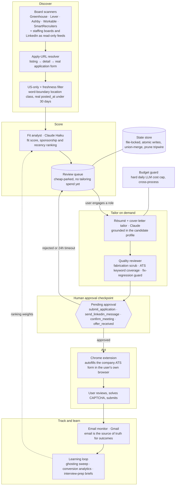

# AutonomousHire

Multi-agent job-search automation, built in Python with LangGraph, Claude, FastAPI and PostgreSQL. Separate agents **discover** roles on companies' own ATS boards, **score** fit, **tailor** a résumé and cover letter on demand, and **track** outcomes from email. Nothing outbound happens without a **human approval checkpoint**: every application, every outreach message, every meeting confirmation waits for a person to approve it.

## Architecture



The LangGraph graph in `orchestration/graph.py` runs the nodes in order: `discover_companies → scan_jobs → score_fit → tailor_resumes → review_quality → submit_applications → monitor_email`. Each node receives and returns one typed `JobSearchState`; a node that fails appends to `state["errors"]` and the pipeline continues. Outreach and interview-prep agents run on their own schedules outside the linear graph.

## The human approval checkpoint

The checkpoint lives in `core/checkpoints.py` and is the one thing every outbound agent has to pass through.

| Gate | What it protects | Waits up to | If nobody answers |
|---|---|---|---|
| `submit_application` | a job application about to be submitted | 24 h | skip |
| `send_linkedin_message` | a recruiter outreach message | 12 h | skip |
| `confirm_meeting` | an interview confirmation on the calendar | 6 h | hold |
| `offer_received` | a job offer | never times out | hold, full user control |

How it works:

1. The agent calls `request_approval(gate_type, payload)`. A pending record is written with the fields a person needs to decide: company, role, apply URL, quality score, résumé preview.
2. The agent blocks on `await_decision(approval_id)` and polls the store until the record is approved, rejected or expired.
3. The person decides in the dashboard (`/approvals`) or from the daily digest. Approving a row in the UI resolves the same checkpoint by apply URL, so the UI and the agent never disagree about what was approved.
4. A timeout falls back to the gate's default, which is never "submit".

Auto-approval exists only for `submit_application`, only behind an explicit environment flag (`AUTONOMOUSHIRE_AUTO_APPROVE=1`), and only on a CAPTCHA-free lane. It is off by default and every auto-approved record is marked as such.

## Why discover on boards and apply on the company ATS

LinkedIn bans accounts for *applying* too much, not for *browsing*. So the two are decoupled:

| | Where | Account risk |
|---|---|---|
| **Discover** a job exists | public ATS board APIs | none |
| **Apply** to it | the company's own ATS form, via a Chrome extension in your browser | none |

Application volume never touches the LinkedIn account.

## Design points that came from running it

- **Tailor on demand.** The queue is filled cheaply (Haiku scoring only). Tailoring with the large model runs only on roles the person actually engages. Sending cheap classification to a small model and keeping the large model for writing cut LLM spend by about 90% with no visible quality loss.
- **Freshness gate.** About 84% of "open" postings pulled from boards were already filled. Capturing the real `posted_at` from each ATS and skipping stale reqs is the single biggest lever on callbacks.
- **Deterministic checks after the LLM.** Prompt instructions alone did not stop the model from inventing metrics, so a fabricated-number scrub and a keyword-coverage gate run after every tailoring step, and a fix-regression guard makes sure a fix does not reintroduce a tell.
- **A state store that survives two writers.** The scheduler and the API were silently overwriting each other's state. The store now uses a file-locked, atomic write-and-rename merge, keeps a PostgreSQL mirror for the UI, and has a prune tripwire that blocks accidental mass deletes.
- **US-only, strict.** Word-boundary location classification plus sponsorship matching; foreign-variant postings of the same role are never queued.
- **Email is the truth.** Outcomes come from the Gmail monitor (read and unread), matched to applications by company and role, not from what the pipeline believes it submitted.

## Stack

- **Backend**: Python 3.12 · LangGraph · FastAPI · APScheduler (macOS launchd) · PostgreSQL (UI mirror) · ChromaDB
- **LLM**: Anthropic Claude (large model for tailoring, small model for scoring and review) with prompt caching, behind a hard daily budget cap; optional OpenAI-compatible provider toggle
- **Frontend**: Next.js + React (review queue, approvals, insights)
- **Apply**: Chrome MV3 extension (form autofill + résumé attach, self-verifying fills with failure telemetry)

## Layout

```
agents/        discovery (board scanners, ATS resolver, fit analyst, targeting),
               application (tailor, quality reviewer, intake, dedup ledger, auto-apply lane),
               outreach, monitoring (email monitor, health), learning (feedback loop), interview (prep)
core/          state_store, checkpoints, budget_guard, llm, decision_sync, config
orchestration/ graph (LangGraph), scheduler (launchd) + CLI runner
api/           FastAPI app (applications, approvals, autofill resolver for the extension)
frontend/      Next.js dashboard
extension/     Chrome autofill extension
tests/         data-integrity, checkpoint and autofill resolver unit tests
```

## Setup

1. `python -m venv .venv && .venv/bin/pip install -r requirements.txt`
2. Copy `.env.example` to `.env` and fill in keys (Anthropic, Gmail OAuth).
3. `frontend/`: `npm install && npm run dev`
4. API: `uvicorn api.main:app --host 127.0.0.1 --port 8000`
5. Scheduler: `python -m orchestration.scheduler` (or the launchd agent).

Secrets live in `.env`; all runtime state and personal data under `data/` is git-ignored.

## Status

Personal project, single user. Not affiliated with any of the companies whose public ATS boards it reads.
